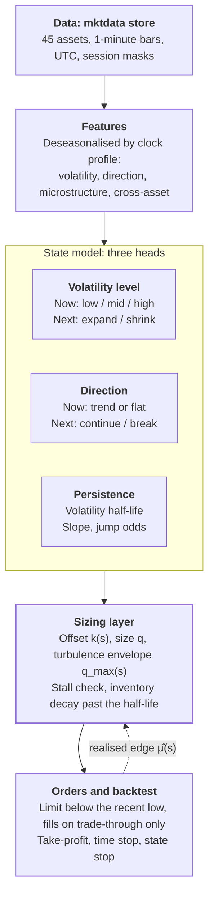

# Turbulence-Adjusted Inventory & Position Sizing for Buy-the-Dip

*Mark · 22 Nov 2026*

## Contents

1. [Thesis](#thesis)
2. [Universe and data](#universe-and-data)
3. [Strategy](#strategy)
4. [State model](#state-model)
5. [Sizing and adjustment layer](#sizing-and-adjustment-layer)
6. [Validation](#validation)
7. [Roadmap and open questions](#roadmap-and-open-questions)

## Thesis

A buy-the-dip strategy should shrink its entry distance and its size as forecast turbulence rises. That way it never holds inventory that a volatility shock can turn into an outsized loss. The idea only earns its keep if it beats plain EWMA volatility targeting out of sample.

The airplane analogy maps one to one:

| Aircraft | Strategy |
| --- | --- |
| Turbulence | Realised and forecast volatility, jumps, spread widening |
| Airspeed | Gross exposure and inventory held |
| Turbulence penetration speed | Maximum inventory per state: large enough to earn the edge, small enough that a 1-in-N shock stays inside the loss budget |
| Stall speed | Minimum size below which fees and spread exceed the edge |
| Load-factor envelope | Hard limits on inventory, layers and drawdown |
| Weather radar | Forward heads of the state model |
| Diverting around a storm | Posting no orders in high-volatility, trend-breaking states |

**Research question:** does conditioning entry offset, size and holding time on a forecast market state cut inventory risk per unit of return? Inventory risk here means time underwater and maximum adverse excursion. The comparison is against constant size and EWMA vol targeting, across 45 assets, 2021–2026.

The formal anchor is Avellaneda–Stoikov market making. A one-sided dip buyer is a liquidity provider, and its reservation price falls with inventory $q$, risk aversion $\gamma$, variance $\sigma^2$ and time left $T - t$:

```math
r_t = s_t - q_t \, \gamma \, \sigma_t^2 \, (T - t)
```

The state model's job is to supply a better $\sigma^2$ and a better horizon than a trailing average does.

### System overview



Each layer only consumes the one above it, so each can be tested alone. Realised fills feed the per-state edge $\hat\mu(s)$ back into sizing.

## Universe and data

The universe is 45 assets of 1-minute bars from January 2021, downloaded with the `mktdata` package into one Parquet store keyed by class, asset, source and month.

| Class | Assets | Default source | Notes |
| --- | --- | --- | --- |
| Crypto (10) | BTC, ETH, XRP, SOL, TRX, ADA, LTC, DOGE, BNB, HYPE | Binance spot archive; Bybit for HYPE | Duplicate ADA replaced by BNB. HYPE history starts late 2024. Trades 24/7. |
| FX (5) | EURUSD, GBPJPY, EURJPY, GBPAUD, EURCAD | Dukascopy (bid and ask) | AUDGBP and CADEUR stored as the market quotes GBPAUD and EURCAD. Closed weekends. |
| Commodities (5) | XAUUSD, XAGUSD, XPTUSD, XPDUSD, XCUUSD | Dukascopy; FTMO MT5 as fallback | Platinum, palladium and copper are thin CFD feeds; check spreads before trusting fills. |
| Equities (25) | AAPL, MSFT, NVDA, AMZN, GOOGL, META, TSLA, AVGO, JPM, V, MA, UNH, XOM, JNJ, PG, HD, COST, LLY, WMT, BAC, KO, PEP, NFLX, AMD, ORCL | Alpaca, split-adjusted | 6.5-hour session plus extended hours; overnight gap is its own regime. |

Data hygiene rules, applied before any feature is built:

- **One clock.** Every timestamp in UTC, bar open time. MT5 server time converted from the New York close convention.
- **Session masks.** Each class gets a mask of tradable minutes. Equities trade regular hours only; FX and metals skip the weekend; crypto never closes.
- **Gaps are events, not bars.** The first bar after a session gap carries a gap flag and is excluded from rolling statistics, so a Monday open does not read as a volatility spike.
- **Split-adjusted equities.** An unadjusted split looks like a 90% dip and would dominate a dip strategy's results.
- **Survivorship.** The 25 equities are large caps chosen today. Treat equity results as optimistic, or rebuild the list from point-in-time index membership.
- **Cross-asset alignment.** Correlations are computed only on minutes where both assets trade, at a coarser grid (5 or 15 minutes) to limit asynchronous-trading bias.

## Strategy

The fixed −1% offset becomes a volatility-scaled offset. On EURUSD, a 1% move is close to a full-day range; on SOL it is minute-level noise. Every distance below is in units of forecast volatility $\hat\sigma_h$ over the holding horizon $h$, so one rule set works across all 45 assets.

**Entry.** Rest a buy limit below the recent low $L_t$, the lowest low over a lookback of $N$ bars:

```math
P^{\text{bid}}_t = L_t \cdot \exp\!\big(-k(s_t)\,\hat\sigma_{h,t}\big)
```

**Exit.** Your second rule, "last close + volatility-adjusted price", is read here as the take-profit. Rest a sell limit above the fill price, plus two stops:

```math
P^{\text{ask}} = P^{\text{fill}} \cdot \exp\!\big(+m(s_t)\,\hat\sigma_{h,t}\big)
```

- **Time stop:** exit at market after $c \times$ the forecast half-life. A dip that has not mean-reverted by then is a trend, not a dip.
- **State stop:** flatten when the state flips to high volatility with an expanding or breaking forecast. This is the storm diversion.

**Fill model.** This is the part that decides whether the backtest is real.

- A buy limit fills only when price trades through it by at least one tick. A touch does not count. For FX and metals the test uses the ask, not the mid.
- Fill price = the limit price. Maker fees or rebates are applied per venue.
- Orders are cancelled and re-posted each bar as $L_t$ and $\hat\sigma$ update, with a one-bar latency.
- Track post-fill drift at 5, 30 and 60 minutes. Fills followed by further falls are adverse selection, the main cost of this strategy.

**Inventory rules.** At most $n$ open layers per asset, a minimum spacing of one $k \cdot \hat\sigma$ between layers, and no new layer while the state stop is active.

| Parameter | Meaning | Starting range |
| --- | --- | --- |
| $N$ | Lookback for the recent low, bars | 60–240 |
| $h$ | Holding horizon for $\hat\sigma$, minutes | 30–240 |
| $k(s)$ | Entry distance, in $\hat\sigma$ units | 0.5–3 |
| $m(s)$ | Take-profit distance, in $\hat\sigma$ units | 0.5–2 |
| $c$ | Time stop, in forecast half-lives | 1–3 |
| $n$ | Maximum layers per asset | 1–3 |

## State model

The state model is split into three separate heads instead of one joint output. The original output, 3 × 3 × 3 current states times 3 × 3 × 3 forward states, is 729 joint classes, too many to calibrate likelihoods for. Frequency, longevity and half-life are continuous quantities, so they become regression targets rather than buckets.

| Head | Current state (estimated now) | Forward target (over horizon h) | Output |
| --- | --- | --- | --- |
| Volatility level | Low / mid / high: terciles of deseasonalised realised volatility, per asset | Expand / flat / shrink: forward RV over h versus current RV | Class probabilities |
| Direction | Directional / flat / unknown: efficiency ratio and trend t-statistic | Continue / break: does the current trend sign persist over h | Class probabilities |
| Persistence | Volatility half-life (AR(1) on log RV) and price mean-reversion half-life (OU fit) | Forward volatility slope, time to revert, jump probability | Continuous values with intervals |

Your "acceleration, expiry, hard-limit" map onto the persistence head. Acceleration is the forward volatility slope. Expiry is the half-life. Hard-limit is the jump probability, since a jump is the move no sizing rule can react to.

**Inputs, grouped by what they measure:**

- **Volatility:** realised volatility at 5, 15, 60 and 240 minutes; Parkinson and Garman–Klass range estimators; bipower variation and a jump flag.
- **Direction:** efficiency ratio, variance ratio, rolling trend t-statistic, distance from the N-bar low in $\hat\sigma$ units.
- **Microstructure:** spread and volume as z-scores against their clock profile; trade count where available.
- **Cross-asset:** absorption ratio (first principal component's share of universe variance) as a systemic stress gauge; rolling betas to BTC, DXY and SPX.
- **Clock:** time of day, day of week, session flag, minutes to a scheduled event (FOMC, CPI, NFP, earnings).

Drop the second difference of minute prices: at this frequency it is almost pure noise. Keep first differences only as inputs to the estimators above. Clock profiles matter most of all. Divide every volatility, spread and volume feature by its time-of-day profile first, or "high volatility" will mostly mean "the US open".

**Dynamics and model ladder.** Climb only when the rung below is beaten out of sample.

1. HAR-RV (daily, weekly and monthly realised-volatility components) for the volatility forecast: the standard baseline.
2. A hidden Markov model on log realised volatility for regime probabilities.
3. Gradient-boosted trees on the full feature set, one model per head.
4. A GRU over the feature sequence, multi-task across the three heads.

Labels are built strictly from data after time $t$, with an embargo of $h$ bars between training and test windows. Class heads are judged on Brier score and reliability curves, because sizing uses the probabilities directly.

## Sizing and adjustment layer

Sizing is derived from the state forecasts with a few explicit formulas, not learned end to end. That leaves only a handful of parameters to fit, which a 2021–2026 sample can support.

**Order size.** Fractional Kelly on the state-conditional edge, capped by the turbulence envelope and by liquidity:

```math
q_t = \min\!\Big( q_{\max}(s_t),\; f \cdot \frac{\hat\mu(s_t)}{\gamma\,\hat\sigma_{h,t}^2},\; \lambda \cdot \overline{V}_{\text{clock}} \Big)
```

Here $\hat\mu(s)$ is the mean net return per fill observed in that state in training, $f$ is the Kelly fraction (start at 0.25), $\overline{V}_{\text{clock}}$ is clock-profile volume, and $\lambda$ caps participation.

**Turbulence envelope.** This is the penetration speed. Pick $q_{\max}(s)$ so that a 1-in-$\alpha$ loss over the holding horizon, jump included, stays inside the per-trade loss budget $B$:

```math
q_{\max}(s) = \frac{B}{P_t \left( z_\alpha\,\hat\sigma_{h}(s) + \hat p_{\text{jump}}(s)\,\hat J(s) \right)}
```

**Stall check.** Skip the order when the expected edge is below the cost of trading:

```math
\hat\mu(s_t) < \text{fee} + \tfrac{1}{2}\,\text{spread}_t + \text{adverse selection}(s_t)
```

**Offset adjustment.** Move entries further out when the forecast is for expansion: $k(s) = k_0 + k_1 \cdot P(\text{expand}) + k_2 \cdot P(\text{break})$. In a turbulent state the strategy buys deeper dips and buys less of them.

**Inventory decay.** Past the forecast half-life, held inventory is cut back on a schedule instead of waiting for the take-profit:

```math
q_{\text{held}}(t) = q_0 \cdot \exp\!\big(-(t - t_0 - \tau_{1/2}) / \tau_{1/2}\big), \quad t > t_0 + \tau_{1/2}
```

**What is learned, and how.** $k_0, k_1, k_2, m(s), f, \gamma$ and $B$ are fitted per asset class with walk-forward Bayesian optimisation, and $\hat\mu(s)$ is estimated per state bucket on training data only. Reinforcement learning over the full action space is a later step, and only if this layer leaves a measurable gap.

## Validation

The state model survives only if it beats EWMA vol targeting on inventory risk per unit of return, out of sample, in at least three of the four asset classes. Every variant runs through the same fill model and costs.

| Variant | Entry offset | Size | Purpose |
| --- | --- | --- | --- |
| B0 | Fixed −1% below the low | Constant | Your original rule, as a reference |
| B1 | k × EWMA volatility | Constant | Isolates the value of vol-scaled entries |
| B2 | k × EWMA volatility | EWMA vol targeting | The null hypothesis to beat |
| B3 | k(s) × forecast σ̂ | Full sizing layer | The proposal |

**Split.** Train on 2021–2023, tune on 2024, and keep 2025 onward untouched until the design is frozen. Inside training, use walk-forward folds purged of overlapping labels with an embargo of $h$ bars.

**Metrics, per asset class:**

- Net return and Sharpe after fees and spread.
- Inventory-weighted time underwater: the sum of position size × minutes held below the entry price.
- Maximum adverse excursion per fill, in $\hat\sigma$ units.
- Time to flat after a state stop.
- Fill rate, and post-fill drift at 5, 30 and 60 minutes (adverse selection).
- Turnover and costs as a share of gross profit.

**Guarding against overfitting.** Report the number of configurations tried and a deflated Sharpe ratio. Check that the fitted parameters are stable across walk-forward folds; a $k_1$ that flips sign between folds is noise.

**Kill criteria.** Drop the state model if B3 does not beat B2 on inventory-weighted time underwater at equal or better net Sharpe. Drop the strategy itself if B1 cannot clear costs in any class. Either result is a valid finding.

## Roadmap and open questions

Each phase ends with a gate. If a gate fails, stop or rethink before building the next layer.

1. **Data.** Run `mktdata` for all 45 assets and check coverage with `mktdata report`. Gate: no missing months outside known listing dates, and spreads look sane per class.
2. **Features.** Build clock profiles, deseasonalised features and session masks. Gate: deseasonalised volatility shows no time-of-day pattern.
3. **Backtester.** Trade-through fill model, fees, latency, B0 and B1. Gate: B1 clears costs in at least one asset class.
4. **Volatility forecast.** HAR-RV, then B2. Gate: HAR-RV beats EWMA on QLIKE loss out of sample.
5. **State heads.** HMM, then gradient boosting, for the three heads. Gate: calibrated probabilities, Brier score better than climatology.
6. **Sizing layer.** B3, fitted walk-forward. Gate: the kill criteria in [Validation](#validation).
7. **Held-out test.** One run on 2025 onward, design frozen beforehand.

### Open questions

- [ ] Lookback for the recent low: a fixed N bars, or the session low?
- [ ] Is the second rule (last close + volatility-adjusted amount) the take-profit, as assumed here, or a second entry?
- [ ] Long only, or a mirrored sell-the-rip side for crypto and FX?
- [ ] Size per asset or one shared risk budget across the portfolio, given the correlation in crypto?
- [ ] Does this live inside the TMRW framework or as a standalone module?
